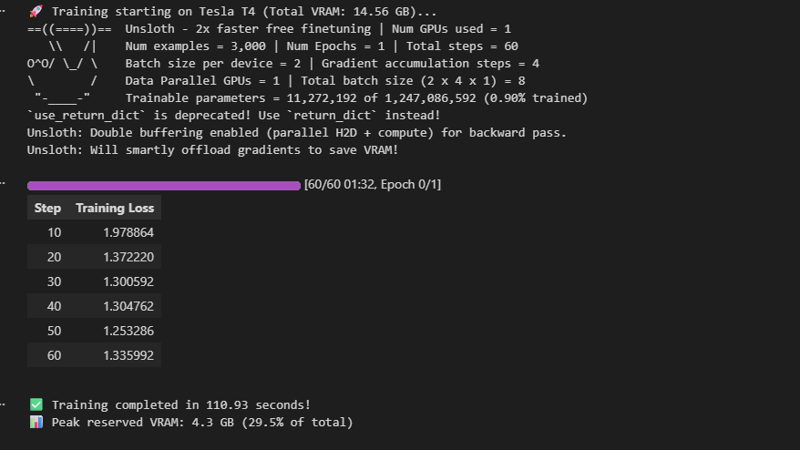

# Odhikar (অধিকার) — AI Paralegal for Legal Aid Clients

[](#)
[](#)
[](#)

## 🎯 Why Odhikar?

Many legal-aid clients may struggle to describe their problems using
formal legal terminology. Odhikar allows clients to describe their
situations naturally in Bangla and progressively structures those
narratives into actionable case information.

The system combines:

- Voice-first interaction for low-literacy users
- Safety escalation for urgent cases
- Domain-specific LLM adaptation
- Human review before complaint generation
- Local inference for privacy-sensitive deployments
---


---

## 🌟 Key Features

1. **Voice-First Bangla Intake**:
   * Voice recording interface with timer and everyday Bangla text fallback.
   * Tolerant of non-linear, emotional narratives without legal jargon.
2. **Safety Escalation (Emergency Break-out)**:
   * Real-time detection of ongoing physical violence or threats on every turn.
   * Instantly halts automated questioning and surfaces emergency hotlines (**16430**, **109**, **999**) while marking the case as **URGENT** in the paralegal queue.
3. **Token Budget & Continuation Control (LangGraph State Checkpoint)**:
   * Dynamically tracks estimated token usage on long or rambling narratives.
   * If token consumption crosses the threshold, the LangGraph flow pauses execution and prompts the user in Bangla: *"আপনার বিবরণটি দীর্ঘ... আপনি কি পরবর্তী টোকেন সম্পন্ন করতে চান?"*
   * Only after the user confirms continuation does LangGraph resume generating subsequent tokens for fact extraction and complaint drafting.
4. **Structured Classification & Fact Extraction**:
   * Powered by **Gemini 3.8 Flash**, **Groq**, and **Fine-Tuned Open-Source LLMs** orchestrated with **LangGraph**.
   * Covers: *দেনমোহর ও ভরণপোষণ (Dower & Maintenance)*, *যৌতুক (Dowry)*, *বকেয়া মজুরি (Unpaid Wages)*, and *জমিজমা সংক্রান্ত বিরোধ (Land Disputes)*.
   * Solves implicit arithmetic (e.g., 10 days × 550 Tk = 5500 Tk, paid 3000 Tk, outstanding 2500 Tk).
   * Explicitly tags inferred facts (`inferred`) so paralegals never mistake guesses for client statements.
5. **Multi-Model Flexibility & Edge Deployment**:
   * Seamlessly switch between cloud providers (Gemini, Groq, OpenRouter) and **locally-hosted fine-tuned models (via Ollama)** for private, offline clinic deployments.
6. **The Model Understands, Templates Speak**:
   * All legal explanations and complaint drafts are assembled from **human-reviewed templates**, eliminating the risk of AI hallucinating legal advice.
7. **Human-in-the-Loop Paralegal Dashboard**:
   * Live incoming queue sorted by urgency.
   * Side-by-side comparison of structured facts and client verbatim words.
   * Built-in complaint editor allowing paralegals to fill placeholders and approve documents.

---

## 🏗️ Project Structure

```text
Odhikar — AI Paralegal/
│
├── backend/
│   ├── agent/              # LangGraph pipeline, prompts, YAML configs, and legal templates
│   │   ├── ai_pipeline.py  # LangGraph state graph (Transcribe -> Safety -> Classify -> Extract -> Dialogue -> Templates)
│   │   ├── prompt_builder.py # Configurable prompt constructor & context assembler
│   │   ├── prompt_config.yaml # Externalized Bengali legal domain prompts & rules
│   │   ├── prompts.py      # Core prompt constants & safety definitions
│   │   └── templates.py    # Reviewed legal complaint drafts & rights explanations
│   ├── middleware/         # Security & auditing middleware
│   │   └── ai_middleware.py# Latency metrics, safety auditing, and input validation
│   ├── utils/              # Multi-model connection & error handling
│   │   ├── model_connection.py # Multi-provider client (Gemini, Groq, Ollama, OpenRouter)
│   │   └── error_messages.py   # Localized user-friendly error translations
│   ├── main.py             # FastAPI server endpoints (Intake, Cases CRUD, CORS, Multi-model)
│   ├── models.py           # SQLAlchemy SQLite database models
│   ├── schemas.py          # Pydantic validation schemas
│   ├── database.py         # SQLite connection setup
│   ├── test_scenarios.py   # Test suite for BRD scenarios (N1, N6, N7)
│   └── requirements.txt    # Python dependencies
│
├── frontend/
│   ├── src/
│   │   ├── App.tsx               # Main container with Client / Paralegal tab navigation
│   │   ├── ClientIntake.tsx      # Voice/Text intake, follow-ups, rights, and safety break-out screens
│   │   ├── ParalegalDashboard.tsx# Case queue, fact inspector, verbatim viewer, complaint editor
│   │   ├── utils/                # Client-side helper utilities
│   │   │   └── draftPdfGenerator.ts # PDF draft generator for paralegal review
│   │   ├── style.css             # Modern responsive styling & design tokens
│   │   └── main.tsx              # React DOM entrypoint
│   ├── package.json        # Frontend dependencies (React, Vite, Axios, Lucide)
│   ├── vite.config.ts      # Vite configuration & backend proxy (/api -> :8000)
│   └── tsconfig.json       # TypeScript configuration
│
├── model_finetuning/       # Domain-specific LLM fine-tuning pipeline for Bangla legal dialogues
│   ├── dataset/            # 17 multi-turn conversations on Bangladeshi Family Law (দেনমোহর)
│   │   ├── custom_dataset.jsonl # Preprocessed & consolidated training dataset
│   │   └── denmohor*.json       # Raw multi-turn dialogue files
│   ├── prepare_dataset.py  # Preprocessor script to validate and consolidate conversations
│   ├── fine_tune.py        # Production CLI script for 4-bit QLoRA training & GGUF export
│   ├── llms_fine_tuning.ipynb # Step-by-step training notebook (Google Colab / Kaggle ready)
│   └── README.md           # Dedicated LLMStudio fine-tuning documentation & benchmarks
│
├── brd.pdf                                          # Business Requirements Document
├── Odhikar_Supporting_Materials_Md. Shaiful Islam 20.pdf # Wireframes & Architecture
├── Odhikar_Test_Narratives_Md. Shaiful Islam 20.pdf     # 8 Scripted Test Narratives
└── README.md
```

---

## 🚀 How to Run the Project

### Prerequisites
* **Python 3.10+**
* **Node.js 18+ & npm**
* An **OpenRouter API Key** (or Gemini API Key)

---

### Step 1: Start the Backend (FastAPI)

1. Open a terminal and navigate to the `backend/` folder:
   ```bash
   cd backend
   ```

2. Create and activate a Python virtual environment:
   * **Windows (PowerShell)**:
     ```powershell
     python -m venv venv
     .\venv\Scripts\activate
     ```
   * **macOS/Linux**:
     ```bash
     python3 -m venv venv
     source venv/bin/activate
     ```

3. Install required Python packages:
   ```bash
   pip install -r requirements.txt
   ```

4. Configure environment variables in `backend/.env`:
   ```dotenv
   OPENROUTER_API_KEY=your_openrouter_api_key_here
   MODEL_NAME=google/gemini-3.8-flash
   PORT=8000
   ```
   *(The backend automatically loads this `.env` file upon startup).*

5. Start the FastAPI server:
   ```bash
   uvicorn main:app --port 8000 --reload
   ```

The backend will be live at:
* **API**: `http://127.0.0.1:8000`
* **Interactive Swagger Documentation**: `http://127.0.0.1:8000/docs`

---

### Step 2: Start the Frontend (React + Vite)

1. Open a new terminal and navigate to the `frontend/` folder:
   ```bash
   cd frontend
   ```

2. Install npm dependencies:
   ```bash
   npm install
   ```

3. Run the development server:
   ```bash
   npm run dev
   ```

4. Open your browser and go to:
   ```text
   http://localhost:5173
   ```

---

## 🧪 Running Automated Tests

To run the automated verification suite against the BRD test narratives (**N1 Baseline Dower**, **N6 Physical Violence Breakout**, and **N7 Out-of-Scope Poisoned Cow**):

```powershell
cd backend
.\venv\Scripts\activate
python test_scenarios.py
```

---

## 📋 Walkthrough Demo Scenarios

In the web interface (`http://localhost:5173`), click **ক্লায়েন্ট সেবা (Client Intake)**. Quick-fill buttons are provided to demonstrate the core flows:

1. **দেনমোহর ও ভরণপোষণ (Scenario N1)**:
   * Demonstrates extracting multiple claims (unpaid dower + withheld maintenance), calculating relative dates, and producing a structured complaint.
2. **বকেয়া মজুরি (Scenario N4)**:
   * Demonstrates extracting verbal agreements, implicit math calculation (10 days × 550 Tk = 5500 Tk), and identifying lack of written contract.
3. **সহিংসতা ব্রেক-আউট (Scenario N6)**:
   * Demonstrates the safety check interrupting the flow mid-conversation, displaying emergency telephone lines (**16430**, **109**, **999**), and flagging the case as **URGENT** in the Paralegal Dashboard.

Switch to **প্যারালিগ্যাল ড্যাশবোর্ড (Paralegal Dashboard)** to view the live case queue, review inferred facts, and edit/approve the complaint drafts.

---

## Cloud Run + self-hosted Llama 3.2 GGUF

To serve the bundled GGUF on GCP and point Odhikar at it (app URL stays the same):

See **[deploy/LLAMA.md](deploy/LLAMA.md)** for upload, deploy, and verification steps (`setup-gcp.sh` → `upload-llama-model.sh` → `deploy-llama.sh` → `deploy-cloudrun.sh`).

---

## 🧠 Domain-Specific Model Fine-Tuning (`model_finetuning`)

To support rural legal clinics with limited internet connectivity and ensure complete data privacy, Odhikar includes an end-to-end LLM fine-tuning pipeline located in [`model_finetuning/`](model_finetuning/).

This module adapts open-weight foundational models (such as **Meta Llama 3.2 1B / 3B** and **Llama 3.1 8B**) to colloquial Bengali legal aid conversations using **[Unsloth](https://github.com/unslothai/unsloth)** and **Hugging Face TRL (`SFTTrainer`)**.

### 🌟 Key Advantages of Fine-Tuning
* **Dialect & Jargon Adaptation**: Deepens understanding of colloquial Bangla legal terms (*দেনমোহর*, *ভরণপোষণ*, *তালাক*, *বকেয়া মজুরি*).
* **High Efficiency**: 4-bit QLoRA reduces VRAM footprint by up to **70%**, enabling training on free **Google Colab T4** GPUs (~16 GB VRAM) or consumer hardware (e.g., RTX 3060/3090).
* **Speedup**: 2x–5x faster training speeds using Unsloth's Triton kernels and manual backpropagation with zero loss in precision.
* **Offline Edge Deployment**: Export directly to **GGUF** for low-latency inference on local clinic computers via **Ollama**.

### 📁 Directory Contents
* [`model_finetuning/llms_fine_tuning.ipynb`](model_finetuning/llms_fine_tuning.ipynb): Interactive 9-section Jupyter notebook configured for Google Colab and Kaggle.
* [`model_finetuning/fine_tune.py`](model_finetuning/fine_tune.py): Production CLI script for headless, server-grade training and quantization.
* [`model_finetuning/prepare_dataset.py`](model_finetuning/prepare_dataset.py): Dataset validator and preprocessor that consolidates dialogue files into JSONL.
* [`model_finetuning/dataset/`](model_finetuning/dataset/): **17 multi-turn conversations** in Bengali regarding Bangladeshi Family Law (দেনমোহর ও ভরণপোষণ) and the preprocessed [`custom_dataset.jsonl`](model_finetuning/dataset/custom_dataset.jsonl).
* [`model_finetuning/README.md`](model_finetuning/README.md): Detailed fine-tuning guide and benchmarks.

### 📊 Dataset Preparation
If you add or update `.json` conversation files inside `model_finetuning/dataset/`, re-consolidate the training data:
```bash
cd model_finetuning
python prepare_dataset.py
```
This validates each conversation turn (`system`, `user`, `assistant`) and generates a clean `custom_dataset.jsonl` ready for the Llama 3 chat template.

### 🛠️ How to Train

#### Option A: Interactive Training via Google Colab / Kaggle
1. Upload [`model_finetuning/llms_fine_tuning.ipynb`](model_finetuning/llms_fine_tuning.ipynb) to Google Colab.
2. Ensure GPU runtime is selected (T4 or A100).
3. Execute the 9 guided sections:
   - Environment & GPU check
   - Dependency installation (Unsloth, TRL, bitsandbytes)
   - 4-bit Base Model loading (`unsloth/Llama-3.2-1B-Instruct` or `3B`)
   - LoRA adapter configuration (`r=16`, `lora_alpha=16`)
   - Dataset loading (`custom_dataset.jsonl`)
   - Baseline pre-training evaluation
   - Supervised Fine-Tuning (`SFTTrainer`) with 8-bit AdamW
   - Post-training validation
   - Multi-target export (LoRA adapter, 16-bit merged weights, or GGUF)

#### Option B: Headless CLI Training (`fine_tune.py`)
Run non-interactive training on a local workstation or GPU server:
```bash
cd model_finetuning

# Train Llama 3.2 3B on the legal dataset
python fine_tune.py \
    --model_name "unsloth/Llama-3.2-3B-Instruct" \
    --custom_dataset_file "dataset/custom_dataset.jsonl" \
    --max_steps 100 \
    --batch_size 2 \
    --gradient_accumulation_steps 4 \
    --learning_rate 2e-4 \
    --mask_prompt \
    --export_gguf "odhikar_llama_gguf" \
    --gguf_method "q4_k_m"
```



### Before finetuning
```
--- Output BEFORE Fine-Tuning ---
<|begin_of_text|><|begin_of_text|><|start_header_id|>system<|end_header_id|>

আপনি একজন বাংলাদেশি পারিবারিক আইন সহায়তা সহকারী। ব্যবহারকারীর সমস্যার ভিত্তিতে প্রাসঙ্গিক পরবর্তী প্রশ্ন করুন।<|eot_id|><|start_header_id|>user<|end_header_id|>

আমার স্বামী আমাকে দেনমোহরের টাকা পরিশোধ করতে অস্বীকার করছে। আমি কি আইনি পদক্ষেপ নিতে পারি?<|eot_id|><|start_header_id|>assistant<|end_header_id|>

Both `max_new_tokens` (=256) and `max_length`(=131072) seem to have been set. `max_new_tokens` will take precedence. Please refer to the documentation for more information. (https://huggingface.co/docs/transformers/main/en/main_classes/text_generation)
এই সমস্যাটি বাংলাদেশের ব্যবহারকারী আইলাইনের সাথে সম্পর্কিত আছে এবং এটি একটি সমস্যা হিসাবে দেখা যেতে পারে এমন সমস্যা হতে পারে এমন কিছু প্রয়োজন রয়েছে। এই সমস্যাটি সমাধান করার জন্য অপারেটিভ পদক্ষেপ নিতে পারেন এম
```

### After Finetuning
```
--- Output AFTER Fine-Tuning ---
<|begin_of_text|><|begin_of_text|><|start_header_id|>system<|end_header_id|>

আপনি একজন বাংলাদেশি পারিবারিক আইন সহায়তা সহকারী। ব্যবহারকারীর সমস্যার ভিত্তিতে প্রাসঙ্গিক পরবর্তী প্রশ্ন করুন।<|eot_id|><|start_header_id|>user<|end_header_id|>

আমার স্বামী আমাকে দেনমোহরের টাকা পরিশোধ করতে অস্বীকার করছে। আমি কি আইনি পদক্ষেপ নিতে পারি?<|eot_id|><|start_header_id|>assistant<|end_header_id|>

Both `max_new_tokens` (=256) and `max_length`(=131072) seem to have been set. `max_new_tokens` will take precedence. Please refer to the documentation for more information. (https://huggingface.co/docs/transformers/main/en/main_classes/text_generation)
এই সমস্যাটি বিচারক সহকারে ব্যবহার করতে হবে। একজন বাংলাদেশি পারিবারিক আইন সহায়তা সহকারী হিসাবে সবচেয়ে দারকৃত স্বামীকে দেন এবং এটি অস্বীকার করে বলছে। তাই এই প্রসঙ্গে বাংলাদেশ পারিবারিক আইন ব্যবহার করে বাস্তবা�
```

### 🦙 Deploying Fine-Tuned Model to Ollama (Edge/Offline Mode)
Once exported to GGUF format (`q4_k_m`), the model can be served locally for Odhikar's intake pipeline:

1. Create a `Modelfile`:
   ```dockerfile
   FROM ./odhikar_llama_gguf/unsloth.Q4_K_M.gguf
   PARAMETER temperature 0.3
   PARAMETER top_p 0.9
   TEMPLATE """<|begin_of_text|><|start_header_id|>system<|end_header_id|>
   {{ .System }}<|eot_id|><|start_header_id|>user<|end_header_id|>
   {{ .Prompt }}<|eot_id|><|start_header_id|>assistant<|end_header_id|>
   {{ .Response }}<|eot_id|>"""
   ```

2. Register and test with Ollama:
   ```bash
   ollama create odhikar-llama -f Modelfile
   ollama run odhikar-llama
   ```

3. Configure Odhikar backend (`backend/.env`):
   ```dotenv
   PROVIDER=ollama
   MODEL_NAME=odhikar-llama
   ```

---

## ⚠️ Limitations

- The fine-tuning dataset is currently limited in size and domain coverage.
- Model-generated facts are explicitly marked as inferred and require
  paralegal verification.
- The system does not replace a qualified lawyer or paralegal.
- Emergency escalation depends on the accuracy of the safety classifier.
- Legal templates require periodic review as laws and procedures change.
